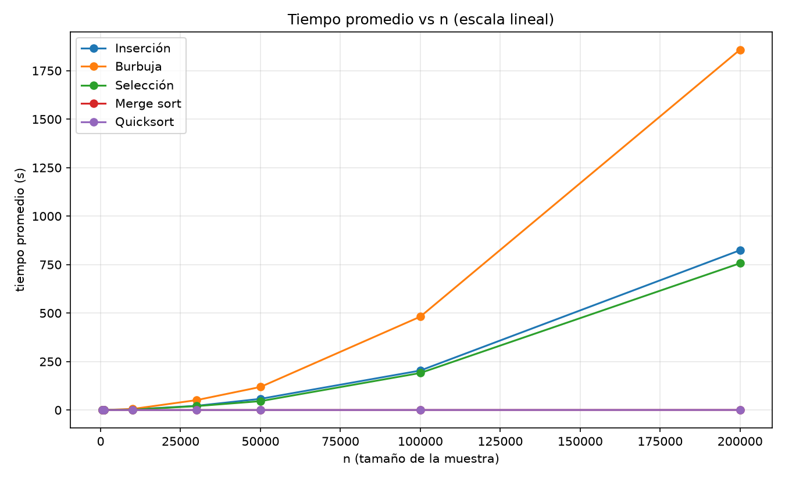
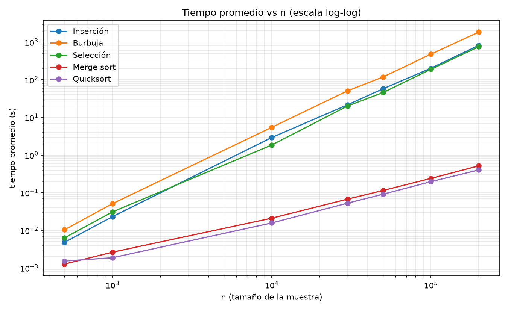
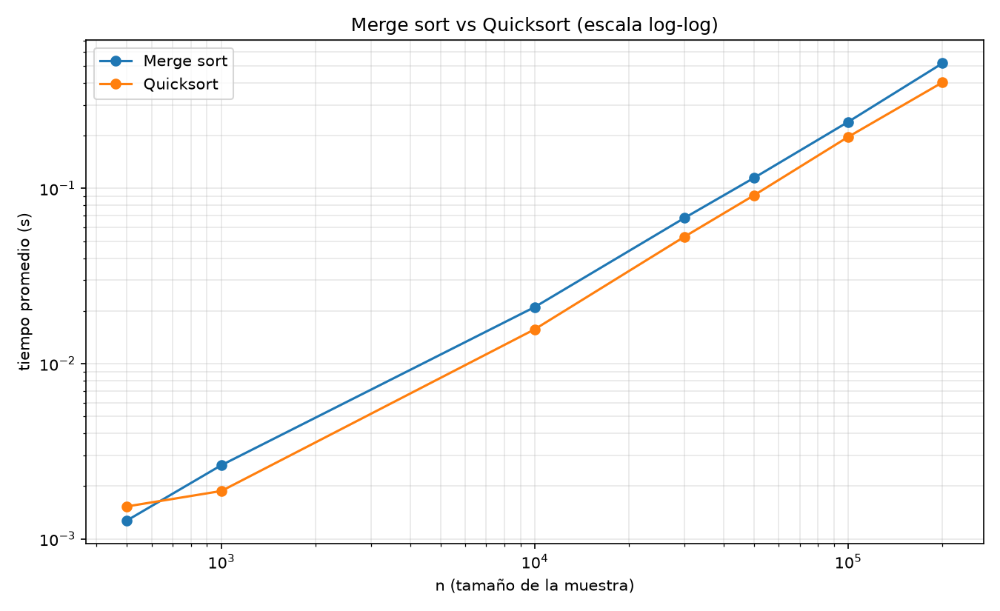
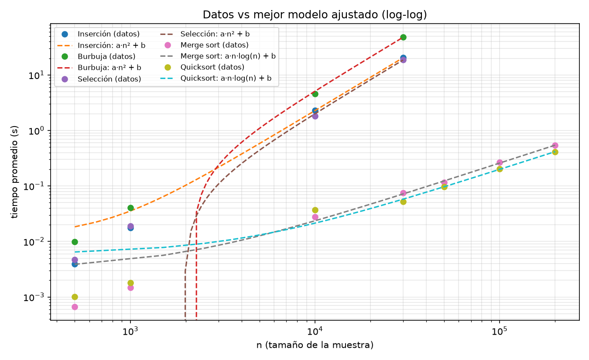

# Taller de ordenamiento: comparación empírica de 5 algoritmos en Python

## 1. Título y objetivo

Trabajo de **Estructura de Datos** (Ingeniería en Ciencia de Datos, UIS). El objetivo es
**implementar a mano** cinco algoritmos de ordenamiento y **compararlos empíricamente**
sobre muestras de una misma lista de 200.000 enteros, midiendo tiempos, graficándolos y
ajustando la función que mejor describe a cada uno.

Algoritmos comparados: **inserción**, **burbuja**, **selección**, **merge sort** y
**quicksort**.

## 2. Algoritmos implementados a mano

Todo el ordenamiento está escrito en el notebook con bucles, comparaciones e intercambios.
**No se usa ninguna función ni librería que ordene**: `sorted()`, `list.sort()`, `heapq`,
`bisect`/`insort`, `numpy.sort`/`argsort`, `pandas.sort_values`/`sort_index`,
`sortedcontainers`, etc. La mezcla de merge sort también se escribe a mano (sin
`heapq.merge`).

- **Inserción**, **Burbuja** y **Selección**: O(n²).
- **Merge sort** (recursivo, con mezcla propia) y **Quicksort** (pivote aleatorio,
  iterativo con pila explícita para no desbordar el límite de recursión): O(n log n).

La validación se hace con `assert`, comparando con `Counter` y una función `es_ordenada`
propia, sin usar `sorted()`, antes del benchmark.

## 3. Estructura del proyecto

```
.
├── README.md
├── requirements.txt
├── .gitignore
├── data/
│   └── numeros.txt              # 200.000 enteros (se regenera con semilla 42, no versionado)
├── results/
│   ├── tiempos.csv              # todas las mediciones (algoritmo, n, repetición, tiempo)
│   ├── promedios.csv            # promedio y desviación por algoritmo y tamaño
│   ├── ajustes.csv              # R², RMSE y mejor modelo por algoritmo
│   ├── tiempos_lineal.png
│   ├── tiempos_loglog.png
│   ├── tiempos_merge_quick.png
│   ├── ajustes.png
│   └── taller_ordenamiento.html # notebook ejecutado, para ver sin Jupyter
└── notebooks/
    └── taller_ordenamiento.ipynb   # notebook principal
```

## 4. Cómo reproducir (Debian + VS Code)

```bash
python3 -m venv .venv
source .venv/bin/activate
python -m pip install -r requirements.txt
python -m ipykernel install --user --name sorting-benchmark --display-name "Python (sorting-benchmark)"
```

En VS Code: abre `notebooks/taller_ordenamiento.ipynb` y selecciona el kernel
**Python (sorting-benchmark)** (el del `.venv`).

Ejecución:

1. Con `QUICK_MODE = True` (valor por defecto) el notebook corre pocos tamaños y 2
   repeticiones en minutos, para validar el flujo.
2. Para el experimento final, cambia a `QUICK_MODE = False` y ejecuta todo (*Run All*).

También se puede ejecutar sin abrir VS Code:

```bash
jupyter nbconvert --to notebook --execute --inplace \
  --ExecutePreprocessor.timeout=-1 \
  --ExecutePreprocessor.kernel_name=sorting-benchmark \
  notebooks/taller_ordenamiento.ipynb
```

> El modo completo tarda **≈ 6,5 h** de CPU. En VS Code conviene dejar la ventana abierta y
> el equipo sin suspender; en terminal se puede desacoplar con `setsid` para que no dependa
> de la sesión.

## 5. Metodología

- **Datos.** Se genera `data/numeros.txt` con 200.000 enteros aleatorios y semilla fija
  (`random.seed(42)`). Es reproducible y no se versiona.
- **Muestras.** Todas son **prefijos** de la misma lista, con tamaños
  **500, 1.000, 10.000, 30.000, 50.000, 100.000 y 200.000**.
  - Nota: el enunciado dice *"cuentas mil"*; se interpreta como **50.000**.
  - La cantidad fue reducida por el profesor de 500.000 a **200.000** enteros.
- **Medición.** Por cada combinación (algoritmo, tamaño) se ordena una **copia**
  (`list(muestra)`) y se mide con `time.perf_counter()`. Se repite **5 veces** cada
  combinación y se promedian los tiempos.
- **Benchmark dividido por tamaño.** El notebook tiene una celda por cada tamaño exigido
  (quinientos, mil, diez mil, treinta mil, cincuenta mil, cien mil, doscientos mil), en
  ese orden.
- **Sin omisiones.** En la corrida publicada se usó `N_MAX_CUADRATICOS = 200.000` y
  `MAX_SEGUNDOS_POR_CORRIDA` muy alto, de modo que los 5 algoritmos corrieron los 7
  tamaños: **175 mediciones** en total.
- **Reanudación.** `REANUDAR = True` permite continuar desde `results/tiempos.csv` si una
  ejecución se interrumpe; las combinaciones ya completadas se saltan.
- **Guardado parcial.** Cada combinación se escribe en `results/tiempos.csv` al terminar;
  el avance en vivo queda en `results/progreso.log` (útil con `tail -f`).

## 6. Resultados

Tiempo **promedio (segundos)** de las 5 repeticiones (`results/promedios.csv`):

| algoritmo | 500 | 1.000 | 10.000 | 30.000 | 50.000 | 100.000 | 200.000 |
|---|---|---|---|---|---|---|---|
| Inserción | 0.0048 | 0.0231 | 2.9313 | 21.7284 | 57.7425 | 203.6178 | 824.0813 |
| Burbuja | 0.0104 | 0.0513 | 5.4596 | 51.0759 | 119.0004 | 481.5771 | 1858.4354 |
| Selección | 0.0063 | 0.0310 | 1.8544 | 20.2051 | 45.7908 | 191.0118 | 756.8591 |
| Merge sort | 0.0013 | 0.0026 | 0.0211 | 0.0678 | 0.1148 | 0.2400 | 0.5185 |
| Quicksort | 0.0015 | 0.0019 | 0.0157 | 0.0530 | 0.0913 | 0.1970 | 0.4034 |

**Costo por bloque de prueba** (5 repeticiones × 5 algoritmos):

| tamaño | tiempo |
|---|---|
| 500 | 0.1 s |
| 1.000 | 0.5 s |
| 10.000 | 51 s |
| 30.000 | 7,8 min |
| 50.000 | 18,6 min |
| 100.000 | 73,1 min |
| 200.000 | **4,78 h** |

Cómputo total: **≈ 6,45 h**.

Ajuste de curvas (`curve_fit`) y pendiente en escala log-log:

| algoritmo | mejor modelo | R² | RMSE | pendiente log-log |
|---|---|---|---|---|
| Inserción | `a·n² + b` | 0.999921 | 2.49 | 2.000 |
| Burbuja | `a·n² + b` | 0.999909 | 6.02 | 2.009 |
| Selección | `a·n² + b` | 0.999970 | 1.41 | 1.930 |
| Merge sort | `a·n·log(n) + b` | 0.999887 | 0.0018 | 0.990 |
| Quicksort | `a·n·log(n) + b` | 0.999765 | 0.0021 | 0.956 |

Gráficas generadas en `results/`:









## 7. Conclusiones

- **La complejidad empírica coincide con la teórica.** Con 7 puntos por algoritmo, los
  cuadráticos se ajustan a `a·n² + b` (R² ≥ 0.9999) con pendiente log-log ≈2; merge sort y
  quicksort se ajustan a `a·n·log(n) + b` con pendiente ≈1.
- **Las constantes importan.** A n = 200.000, quicksort es **≈4607× más rápido que burbuja**
  (0.40 s vs 31 min) y merge sort **≈1589× más rápido que inserción** (0.52 s vs 13.7 min).
- **Burbuja es el peor de los cuadráticos** porque intercambia en cada inversión: tarda
  ≈2,26× más que inserción. Inserción y selección quedan casi empatadas (1,09×).
- **Escalabilidad.** Duplicar n de 100.000 a 200.000 multiplica el tiempo del bloque por
  ≈3,9 (cerca del 4 de n²). El bloque de 200.000 consumió 4,78 h de las 6,45 h totales.
- **Qué dice la gráfica:** en escala lineal los O(n²) se disparan y aplastan a los O(n log n);
  en **log-log** las pendientes (≈2 vs ≈1) separan las familias y dejan ver las constantes
  (altura) y la escalabilidad.

## 8. Limitaciones

- Los tiempos son de **un solo equipo** (CPython 3.14) y no están aislados del ruido del
  sistema (GC, planificador); por eso se reportan promedios de 5 repeticiones y su
  desviación, que en los cuadráticos llega a varios segundos.
- Las muestras son **prefijos de la misma lista**; no se promedian muchas listas distintas.
- La corrida completa exige **≈ 6,5 h** de CPU y depende de que el proceso/equipo no se
  interrumpa. `REANUDAR = True` mitiga los cortes, pero reanudar mezcla mediciones de
  sesiones distintas (misma configuración y equipo).
- Merge sort usa memoria auxiliar O(n); quicksort ordena in-place.
- Los tiempos absolutos dependen del hardware; el interés está en las **tendencias**.

## 9. Archivos para la entrega

| archivo | contenido |
|---|---|
| `notebooks/taller_ordenamiento.ipynb` | entregable principal: 5 algoritmos, validación, benchmark completo (175 mediciones), tablas, gráficas y conclusiones |
| `results/taller_ordenamiento.html` | el mismo notebook exportado a HTML (se abre en cualquier navegador, sin Jupyter) |
| `results/tiempos.csv` | las 175 mediciones crudas |
| `results/promedios.csv` | promedio y desviación por algoritmo y tamaño |
| `results/ajustes.csv` | comparación de modelos (R², RMSE, pendiente log-log) |
| `results/*.png` | las cuatro gráficas |
| `README.md` | objetivo, metodología, resultados y conclusiones |
| `data/numeros.txt` | datos (no versionado; se regenera con semilla 42 al ejecutar) |

Para revisar la entrega sin ejecutar nada: abrir `results/taller_ordenamiento.html`.
Para reproducir el experimento: seguir la sección 4.
